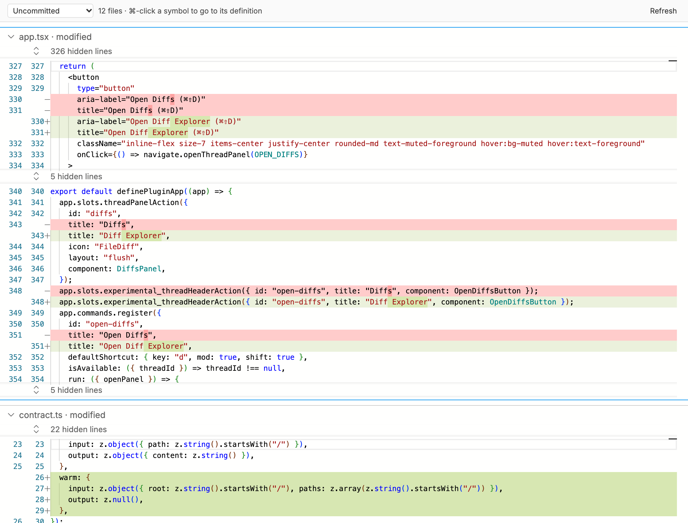
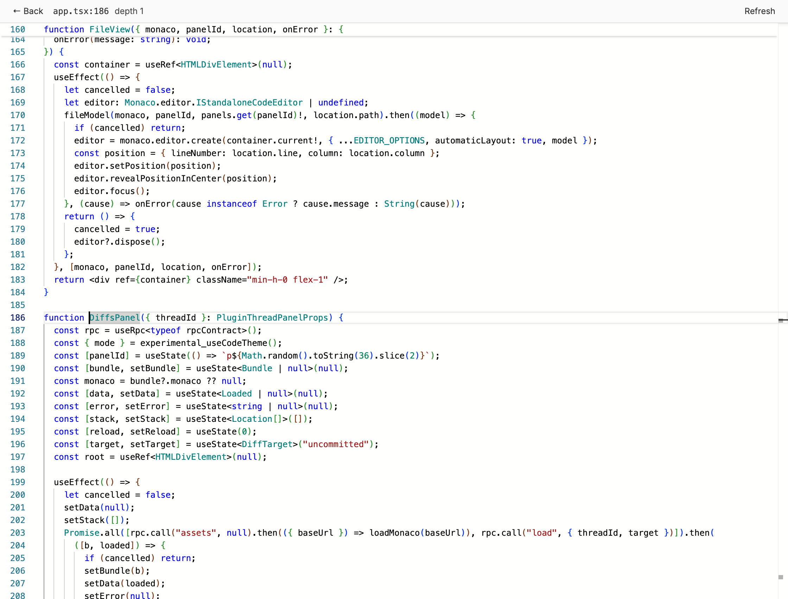

# Diff Explorer

A [BB](https://getbb.app) plugin. Review a thread's changes, and jump into the code behind them.



## What it does

- Shows every changed file in one scrolling view.
- Switches between **Uncommitted** and **All changes** since the base branch.
- **✓** launches Claude Haiku to review and commit uncommitted changes; **✓✓** also pushes the current checked-out branch to the same branch name on its configured remote (or `origin` when there is no upstream). Both actions save pending editor changes first and operate on uncommitted files even when viewing **All changes**. **View commit agent** opens the agent's thread for its review, commit message, and result. A second agent cannot start in the same environment while the first is running.
- The commit writer explains why the changes were made in one summary sentence, followed by two or three sentence bullets. It uses tested `commit-review` and `commit-finish` commands for snapshots, staging, hooks, commits, and pushes. It stops on review blockers or helper failures. Claude Code with an available Haiku model is required on the checkout's host; the agent uses the source thread's permission mode.
- Press **⌘F** (or click **Find**) to search the before and after text of all loaded diffs, including off-screen files and collapsed sections. Search is case-insensitive and literal. **Enter** / **Shift+Enter** move between matches; **Escape** closes Find. Before-text matches temporarily open side by side so the original text can be selected.
- ⌘-click a symbol (or press F12) to open its definition.
- Jump again to go deeper. Press **Ctrl+-** to go back one level.
- Opens from the thread header button, or with **⌘⇧D**.
- If autosave detects a disk conflict, the file's **Discard edit and reload** action replaces only that editor's unsaved text with the current disk version. Ordinary refreshes preserve unsaved edits.



## Install

```sh
bb plugin install git:https://github.com/arashout/bb-plugin-diff-explorer.git
```

## Go to definition needs a language server

| Language | Server (on your PATH) |
|---|---|
| TypeScript, JavaScript | Node.js 20+ with `npx` (downloads pinned TypeScript 5.9.3 and language server 5.1.3 on first use) |
| Go | `gopls` |
| Rust | `rust-analyzer` |
| Python | `pyright-langserver` |
| C, C++ | `clangd` |
| Swift | `sourcekit-lsp` |

Other languages still show the diff.

## Commit commands

Successful commit threads archive automatically after the agent finishes its final report. Review blockers, commit failures, and push failures leave the thread open for inspection.

The toolbar's agent receives a job ID and runs:

```sh
bb diff-explorer commit-review <job-id>
bb diff-explorer commit-finish <job-id> --message-file /absolute/path/to/message.txt
```

Review returns an immutable diff without changing the real index. Finish checks HEAD, branch, staging, and selected content, then commits the reviewed tree while preserving unrelated staging. Existing hooks run through guards; a failed hook or a hook that changes the selected files, tree, or message stops the commit. Working edits left by hooks are preserved. Push uses the committed hash and the current branch's name with an explicit, non-forced refspec. A failed push leaves the local commit intact.

Finish allows one attempt per job, including across reloads. Failed or stale jobs require a fresh toolbar click and review. Message files are read on the checkout's host, under its temporary directory or the checkout, and must be smaller than 16 KB. Large review diffs fail instead of being truncated. The helper requires individual files in a repository-root workspace; detached HEAD, conflicts, and in-progress merge/rebase/cherry-pick operations are refused.

## Issue reports

**Report issue** saves diagnostics to the plugin's inbox without sending a
thread message or starting an agent. **Settings → View reports** opens the latest 20 snapshots
from all threads. Each snapshot has an ID, timestamp, source thread ID, and
setup details; it excludes file contents.

Reports use BB's plugin key-value storage in `bb.db`. They survive plugin
reloads, BB restarts, and source-thread deletion. Older reports remain stored
and can be retrieved by ID. This is local BB storage, so its durability depends
on keeping or backing up the BB data directory.

```sh
bb diff-explorer reports
bb diff-explorer report <id>
```

## Develop

Use pnpm 10.34.6 and Node 22.23.3 from this directory:

```sh
pnpm install --frozen-lockfile
pnpm run typecheck
pnpm test
pnpm run build:monaco   # after changing scripts/multi-diff.js, scripts/diff-search.js, or Monaco
bb plugin install .
```

The install step builds `monaco/` from the exactly pinned `monaco-editor` and `esbuild` production dependencies. Generated editor, worker, CSS, font, and license assets are ignored by Git. Local npm/pnpm installs use `postinstall`. BB's Git installer disables npm scripts and omits development and optional dependencies, so the plugin's BB install hook runs the same build, with a fallback on the first asset request. The build invokes esbuild's pinned installer to supply and verify its platform binary when npm omitted it; installation may need registry access for that binary. Local path installs require the dependency install above first. `bb plugin build` by itself does not generate Monaco assets; `pnpm run build:monaco` explicitly regenerates them after editor source changes.

Dependencies use exact versions and a committed pnpm lock. Install scripts are
blocked unless their package and version are approved in `pnpm-workspace.yaml`;
newly published versions must be at least one day old. CI rejects high or
critical dependency advisories, and its GitHub Actions use pinned commit hashes.

BB's Git plugin installer currently uses npm, so `package-lock.json` remains
as its compatibility lock. After a dependency update, regenerate that lock with
`npm install --package-lock-only --ignore-scripts --legacy-peer-deps`, then run
`node scripts/check-dependencies.mjs` and `pnpm install --frozen-lockfile`.

## License

MIT. Bundles Monaco and code adapted from VS Code (both MIT, © Microsoft).
