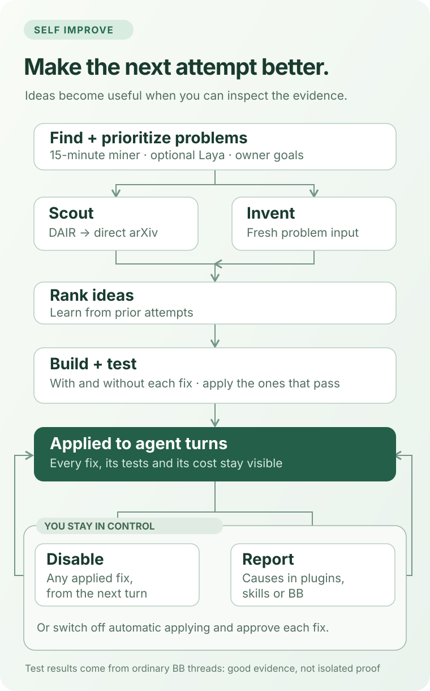

# Self improve

**Find the friction. Try an idea. Keep the evidence.**

Self improve gives your BB agents a learning ledger: problems worth solving, possible fixes, the experiments behind them, and the cost of finding out. Failed attempts stay in the story.

> **Draft preview.** BB-native execution is being integrated and validated. You can review the ledgers and configuration experience; this is not a completed release or a claim of real-world improvement. Native build experiments are exploratory. Automatic held-out adoption and the full Promote/Revalidate workflows remain unfinished.



## Start with one thing you wish worked better

Open **Self improve → Add problem / goal**. Describe a recurring annoyance, or choose a measurable goal: “test feedback time, seconds, lower than 30.” Owner requests are recorded as requests; they do not become invented failure observations.

| View | What you can inspect |
| --- | --- |
| **Problems** | Symptoms, evidence pointers, owner goals and linked solutions. |
| **Testing** | Candidate ideas, predictions, scores, attempts and reasons to defer. |
| **Established** | Retained adoption history, current activation qualifications and basic re-test/export actions. |
| **Performance** | Recorded observation windows, exposure, confounders and costs. Empty means no measurements yet. |

Select **Explore and edit in chat** to open BB's own `ThreadChat` for a record. Ledger edits use version checks and audit reasons. A conversation cannot mint trusted evaluation receipts.

## Your BB, your provider

Choose the worker project and environment in configuration, then open **Execution** above the dashboard. BB's provider/model and permission pickers select how the work runs. Agent stages and ledger chat use BB threads, existing sign-in, and BB's available account routing. Self improve does not require a separate Anthropic endpoint, API-key pool or model gateway.

A fresh task receives fresh plugin input. Ordinary BB, provider and workspace instructions or tools may still be available. That distinction matters for testing: a fresh prompt does not establish held-out isolation.

## Try the draft in scratch BB

Use the exact preview revision supplied with the draft PR, or a local checkout of that revision. There is no released `main` installation promised by this draft README.

In a terminal **already connected to a disposable scratch BB instance**, from this plugin directory:

```sh
npm ci
npm run typecheck
npm run build
bb plugin install "$PWD"
bb self-improve doctor
```

The scratch instance needs its own data directory and worker environment, with server/daemon ports such as `48886`/`48887`. Do not point these commands at your live BB. Use the supported BB sign-in flow there; do not copy credentials from another installation. The final preview installation recipe and both provider paths still need validation at the delivered revision.

The package currently declares BB `>=0.49` and SDK `>=0.6.132`; that declaration is not proof that every host version supports every experimental surface. Start with [setup](docs/setup.md). Scheduling and unknown-cost authorization both default to **off**.

## Where ideas come from

The **miner** looks for recurring symptoms every 15 minutes. Optional asynchronous Laya detection can request an earlier pass from recent redacted context. It excludes this plugin's workers and keeps the scheduled fallback.

The **scout** uses DAIR and then direct **arXiv**. Missing article text or credibility metrics remain unknown. The **inventor** gets a fresh problem-only input from this plugin, with no papers or prior solutions added. It must state assumptions and dependencies; ordinary native context limits still apply.

The **solution ranker** considers the proposed effect, feasibility, effort and prior attempts. The **builder** currently proposes reusable instructions and compares development-case outputs through BB. Those results are exploratory; this native execution path has no verified held-out isolation and cannot automatically adopt them. The **verifier** records qualified observational evidence where the required history exists.

## Verification is not the finish line

The target impact screen offers **Promote** and **Revalidate**. Promote packages an exact verified revision, reviews its claims and dependencies, and follows submission through actual repository publication and optional marketplace listing. Revalidate turns “I'm skeptical about this claim” into measurable criteria and new tests of the unchanged revision.

Those full workflows are **planned, not delivered in this preview**. The existing basic re-test and export/draft-PR controls are foundations. The Performance view can also [check recorded publication state](docs/publication-tracking.md). A draft PR is a review submission, not a published release, marketplace listing or activation. Historical direct-model proof does not validate a new BB-native environment.

## Count the cost of learning

BB usage receipts identify tasks, conversations and reported session amounts. Reports may be incomplete; subscription tokens do not become an invented API invoice. Historical estimates and owner-entered charges keep their labels. Spending thresholds stop further work using available observations; they cannot guarantee a dollar ceiling on a native turn already running.

Every agent session is tracked with the tokens and cost BB reports; [costs](docs/costs.md) shows where to see it and how to set optional limits.

## Read next

- [Setup](docs/setup.md): configure a scratch preview and add the first problem.
- [Configuration](docs/configuration.md): execution, schedules, privacy and research.
- [How the loop works](docs/how-it-works.md): evidence, current behavior and the complete target lifecycle.
- [Costs](docs/costs.md): reported, estimated and unknown amounts.
- [Troubleshooting](docs/troubleshooting.md): deferred work, stale settings and evidence gaps.
- [Task outcome sources](docs/task-outcomes.md): connect authoritative failed/blocked task history.

The illustrations explain the design. They are not screenshots or benchmark results. Older specialist guides are still being reconciled with this architecture; these preview guides describe the current execution boundary.
