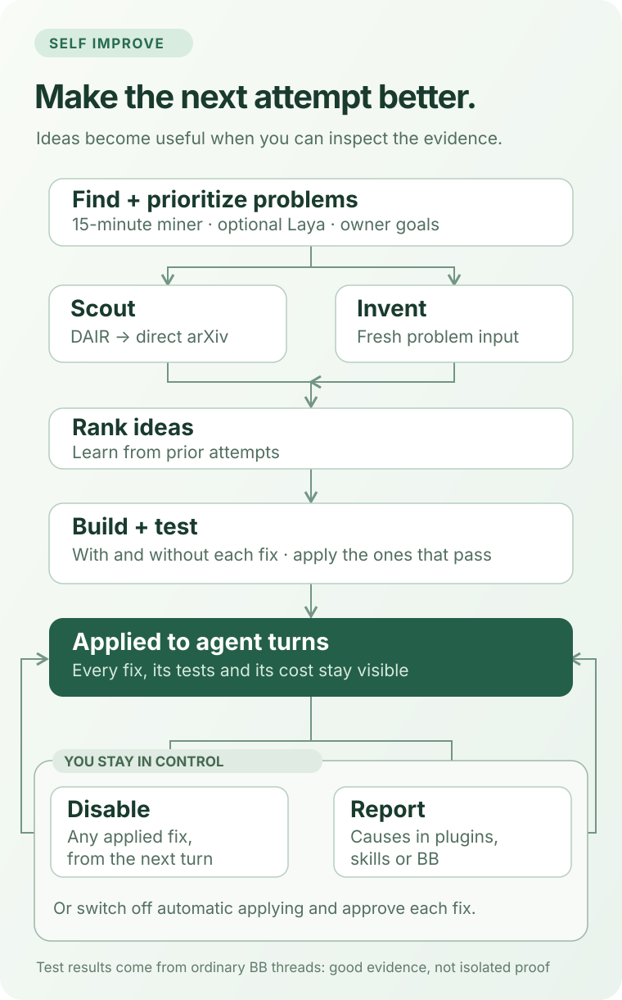

# How the loop works

A hypothesis, a test result and a measured improvement are different records. Self improve links them so you can inspect how a claim was reached.

## Seven services

| Service | Default schedule | Output |
| --- | --- | --- |
| Miner | Every 15 minutes; reconciliation at 01:00 | Generalized problems, symptoms and evidence-linked votes. |
| Problem ranker | 02:00 | A weighted snapshot, owner focus and wildcard slots. |
| Scout | 02:15 | DAIR/direct-arXiv proposals and source provenance. |
| Inventor | 02:15 | Fresh problem-led hypotheses with assumptions and dependencies. |
| Solution ranker | 03:00 | An explained queue after both proposal streams finish. |
| Builder | 03:15 | Exploratory development-case attempts; native adoption remains blocked. |
| Verifier | 04:00 | Qualified observation windows and provider/model revisit work. |

Daily times use the server's local timezone. BB owns service scheduling and restart behavior. Durable jobs and task identities preserve attribution across retries. A queued or deferred job is not a completed experiment.

Optional Laya detection asynchronously examines recent redacted context and can request mining sooner. It is an early hint, not a verdict, and never replaces periodic mining. This plugin's own worker activity is excluded from the learning signal.

## Follow a problem through the ledger

A **problem** has symptoms, working causes and evidence pointers. A **solution** has a mechanism, linked problems, predicted effect, test plan, attempts and provenance. Prior rejected, failed and removed attempts remain useful history. Deduplication keeps source provenance.

Problem scores use weighted observations, decay and source caps. Owner goals and focus are separate inputs, not fabricated observations. The scout reads available research; missing full text or credibility evidence stays unknown. The inventor receives only the sanitized problem and task from this plugin, without papers or earlier solutions. Ordinary BB/provider/workspace context can remain, so “fresh input” does not mean enforced global isolation.

The solution ranker assesses fit, benefit, testability, feasibility, safety and effort, including prior history and portability assumptions. Those scores are estimates.

## What testing currently proves

The native builder proposes reusable instructions and compares exact development-case outputs through BB threads. It retains the attempted revision, execution identity and result. It does not dispatch held-out cases, create independent isolation proof or automatically adopt a passing development result.

Historical adoption/evaluation records remain readable. They do not authorize new native activation: the dashboard shows **revalidation required**, and new turns do not receive those historical artifacts from the plugin. Existing provider conversations may still retain earlier instructions.

A basic **Re-test solution** request preserves previous evidence and reuses an already-pending job for the same revision. Successful job execution does not mean the claim passed. Native exploratory results remain **needs review** with the adoption gate blocked; failures and inconclusive work stay separate.

## The full target lifecycle

The intended impact screen keeps three facts distinct: **evidence**, **distribution**, and **activation**.

**Promote** will select an exact verified revision, supported claims and intended scope; package it as a skill/plugin; review dependencies and the exact files; validate the packaged artifact; and submit to an explicit repository. Actual repository publication/release, optional marketplace listing and activation are separate states. Later versions preserve earlier releases and evidence.

**Revalidate** will start with a skeptical claim, help clarify measurable criteria in BB chat, freeze a versioned plan, and test the unchanged artifact. It will distinguish replay, new challenges and independent held-out proof, then record supported/contradicted/inconclusive outcomes separately from execution failures. Fixing the artifact creates a new revision needing new validation.

The revalidation engine is in place on the server; its dashboard wizard is not built yet. You (or the editing chat) write test cases, each an input and the exact expected answer, plus pass criteria. You freeze the plan, which records the exact instruction and your worker settings, and queue it. Each case runs twice in fresh BB threads, once without the instruction and once with it, and the server scores the answers:

- Answers must be JSON `{"output": "..."}`, optionally in one code fence. Anything else counts as a failed case, and the result shows how many answers were unreadable.
- A verdict is recorded only when every call finished. If you cancel, the plugin is turned off, the worker settings change, the time limit passes or a call fails, the run stops with a reason and no verdict.
- The latest completed run of the latest frozen plan decides the claim's standing. Earlier results stay in the history.

Both complete workflows remain **pending in this preview**. Existing basic retest and draft export controls are foundations. A draft PR is submitted for review; it is not published, listed or active. This pending work remains part of the delivery scope.

The solution detail shows **Tested on**, **Requires**, and **Not yet tested**. New inventor and scout proposals carry an unverified declaration of dependencies, assumptions and proposed package checks. Older records without a declaration remain unknown. The panel does not claim a tested environment until package conformance evidence is available. Provider/model, plugin, skill or configuration changes can require revalidation. Prompts and reviews help reveal assumptions; testing the advertised package/configuration establishes the actual scope.

## Read performance carefully

The verifier compares relevant symptom votes per fully mined selected session-day, with selection capped at one session per task/day. Typical baseline and follow-up windows span seven days around historical activation. Minimum exposure, coverage, model identity and instruction-exposure evidence qualify the result.

**SOLVED**, **REDUCED**, **NO EFFECT**, **WORSE** and **PENDING** are observation verdicts, not proof that a nonrandomized change caused an effect. Charts retain counts, rates, gaps, confounders and cost snapshots. No data means no measurement, not zero failures or proven success.

## Keep the receipts

SDK-owned SQLite stores versions, jobs, costs, attempts and audit history. JSON/JSONL/Markdown reports are derived exports, not an editing API. Use the dashboard, audited chat tools or documented CLI to make changes.

Fixture checks, real-model runs and longitudinal efficacy are separate evidence. None substitutes for the others, and interrupted experiments remain unknown until their state is recovered.
